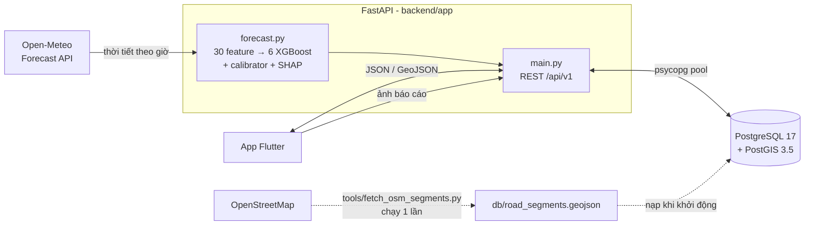
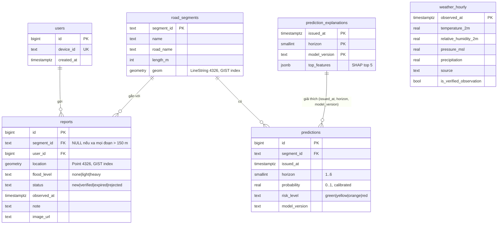

# Kiến trúc hệ thống và API contract

## 1. Kiến trúc



Luồng một lần dự báo:

1. Request đầu tiên trong mỗi giờ gọi `ensure_latest_run()`. Hàm này lấy thời tiết Open-Meteo của giờ tròn gần nhất, tạo đúng 30 feature như lúc train (dùng lại code `ml/src/features/18_build_live_features.py`), chạy 6 mô hình XGBoost h1–h6, hiệu chỉnh xác suất và tính SHAP (dùng lại `ml/src/models/17_predict.py`).
2. Kết quả được ghi vào `weather_hourly`, `prediction_explanations`, và `predictions` cho **mọi** đoạn đường. Các request khác trong cùng giờ chỉ đọc DB. Có lock nên dù nhiều request đến cùng lúc thì mỗi giờ cũng chỉ chạy inference 1 lần.
3. Nếu Open-Meteo lỗi, API trả lần dự báo gần nhất (không quá 3 giờ) kèm `"stale": true`. Quá 3 giờ thì trả 503.
4. `model_version` là hash nội dung các file model và calibrator, nên mỗi lần train lại sẽ ra version mới và lịch sử dự báo không bị lẫn.

**Giới hạn cần nói rõ khi báo cáo:** mô hình chỉ có một điểm đầu vào (10.85, 106.77), nên mọi đoạn đường trong cùng một lần dự báo có cùng xác suất. Phần khác nhau giữa các đoạn hiện chỉ đến từ báo cáo cộng đồng (`report_summary`). Mức rủi ro dùng 4 ngưỡng cố định trong `config.RISK_BANDS` (<10% xanh, <30% vàng, <60% cam, còn lại đỏ). Các ngưỡng này **chưa được kiểm chứng** bằng dữ liệu ngập.

## 2. ERD



`predictions` có ràng buộc `UNIQUE (segment_id, issued_at, horizon, model_version)` và chỉ được ghi bằng `ON CONFLICT DO NOTHING`, nên lịch sử dự báo không bao giờ bị ghi đè. Toàn bộ schema nằm trong [../db/schema.sql](../db/schema.sql).

## 3. API contract (`/api/v1`)

Chi tiết từng trường xem ở Swagger `/docs`. Mọi thời gian trả về theo ISO 8601 múi giờ `+07:00`. Lỗi luôn có dạng `{"detail": ...}`.

| Method | Path | Dùng cho | Mã lỗi chính |
|---|---|---|---|
| GET | `/health` | Kiểm tra API + DB | 503 DB lỗi |
| GET | `/api/v1/road-segments` | Vẽ đoạn đường (GeoJSON) | |
| GET | `/api/v1/road-segments/{segment_id}` | Một đoạn | 404 |
| GET | `/api/v1/weather/current` | Thời tiết giờ gần nhất | 503 |
| GET | `/api/v1/forecast/{segment_id}` | Màn Forecast +1…+6h | 404, 503 |
| GET | `/api/v1/predictions?segment_id=&start=&end=&horizon=` | Lịch sử dự báo | 404, 422 |
| GET | `/api/v1/explain/{segment_id}?horizon=1` | Màn "Tại sao cảnh báo?" | 404, 422, 503 |
| GET | `/api/v1/map/risks?horizon=` | Bản đồ rủi ro + legend + tóm tắt báo cáo | 503 |
| POST | `/api/v1/uploads` (multipart `file`) | Tải ảnh báo cáo, trả `image_url` | 413, 415 |
| POST | `/api/v1/reports` | Gửi báo cáo cộng đồng | 409 trùng, 422 |
| GET | `/api/v1/reports?segment_id=&status=&limit=` | Lịch sử báo cáo | 422 |
| PATCH | `/api/v1/reports/{id}/status` + header `X-Admin-Token` | Duyệt `verified` / `rejected` | 401, 403, 404, 409 |

### Forecast: giữ đúng định dạng mock của app (`mobile/assets/mock/forecast_TD01.json`)

```json
{
  "segment_id": "SEG01",
  "name": "Kha Vạn Cân (đoạn 1)",
  "issued_at": "2026-11-12T09:00:00+07:00",
  "timezone": "Asia/Ho_Chi_Minh",
  "model_version": "xgb-final-2c5f62452555",
  "is_mock": false,
  "stale": false,
  "horizons": [{"h": 1, "probability": 0.0003, "level": "green"}, "... đủ 6 phần tử h = 1..6"],
  "disclaimer": "Xác suất mưa lớn (≥ 30 mm trong 3 giờ) ..."
}
```

### Road segments: giữ đúng định dạng `mobile/assets/mock/road_segments.geojson`

`FeatureCollection`, mỗi feature có `properties.segment_id`, `properties.name` (thêm `road_name`, `length_m`), `geometry` là `LineString` với toạ độ `[lon, lat]`.

### Map risks

Giống road segments, nhưng `properties` có thêm:

```json
{"probability": 0.31, "risk_level": "orange",
 "report_summary": {"active": 2, "flooded": 1, "latest_at": "2026-11-12T10:05:00+07:00"}}
```

Ở cấp ngoài có `issued_at`, `stale`, `horizon` (`null` nghĩa là lấy mức cao nhất trong 6 giờ) và `legend`:

```json
[{"level": "green", "label": "Thấp", "max_probability": 0.1}, "... yellow 0.3, orange 0.6, red 1.0"]
```

### Explain

```json
{"segment_id": "SEG03", "horizon": 2, "probability": 0.0002, "level": "green",
 "features": [{"feature": "rain_last_1h", "label": "Tổng mưa 1 giờ qua", "value": 0.0,
               "impact": -2.07, "direction": "decreases",
               "text": "Tổng mưa 1 giờ qua = 0 mm → làm giảm nguy cơ"}],
 "note": "Mức đóng góp (SHAP, log-odds) ... không phải quan hệ nhân quả."}
```

### Gửi báo cáo

1. (Nếu có ảnh) `POST /api/v1/uploads` dạng multipart với trường `file` → `{"image_url": "/uploads/<id>.jpg"}`. Server chỉ nhận JPEG/PNG/WebP, tối đa 5 MB, và kiểm tra nội dung byte chứ không tin vào tên file.
2. `POST /api/v1/reports`:

```json
{"lat": 10.8505, "lon": 106.7718, "flood_level": "light",
 "observed_at": "2026-11-12T10:00:00+07:00", "note": "Ngập tới mắt cá",
 "image_url": "/uploads/<id>.jpg", "device_id": "android-3f9c2a1b"}
```

Các trường bắt buộc là `lat`, `lon`, `flood_level`. Các quy tắc phía server:

- **Gán đoạn đường:** không gửi `segment_id` thì server tự gán đoạn gần nhất trong 150 m (PostGIS `ST_DWithin` + KNN `<->`).
- **Vị trí:** phải nằm trong TP Thủ Đức, nếu không trả 422.
- **Thời gian:** `observed_at` không được ở tương lai và không cũ hơn 6 giờ, nếu không trả 422.
- **Chống trùng:** nếu đã có báo cáo còn hiệu lực cùng `flood_level`, cách dưới 100 m và lệch dưới 30 phút thì trả 409 kèm `duplicate_of`. Khi có `device_id` thì chỉ so với báo cáo của chính thiết bị đó.
- **Hết hạn:** báo cáo `new` hoặc `verified` cũ hơn 6 giờ tự chuyển sang `expired`, nên không hiển thị như tin mới.
- **Ẩn mặc định:** báo cáo `rejected` không xuất hiện trong danh sách trừ khi lọc `status=rejected`.

## 4. App Flutter chuyển từ mock sang API thật

Hai hàm trong `ApiService` của app đã có endpoint với đúng định dạng:

| `ApiService` | Endpoint |
|---|---|
| `getRoadSegments()` | `GET /api/v1/road-segments` (hoặc `/api/v1/map/risks` để có thêm màu rủi ro) |
| `getForecast(segmentId)` | `GET /api/v1/forecast/{segmentId}` |

Base URL khi chạy trên máy ảo Android là `http://10.0.2.2:8000`. Bản release gọi `http://` cần bật `android:usesCleartextTraffic="true"` trong `AndroidManifest.xml`.
