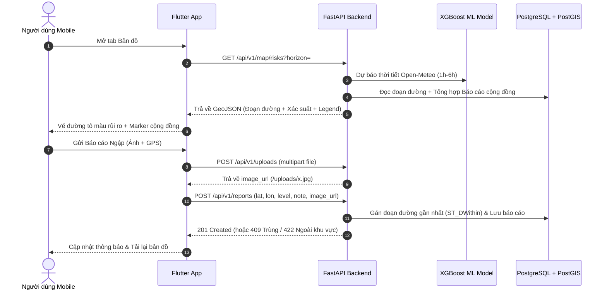

# Báo cáo Kỹ thuật Phần Mobile (Flutter App) - Đồ án Cảnh báo Mưa lớn TP Thủ Đức

Tài liệu chi tiết đóng góp phần Mobile (Tường) cho báo cáo đồ án cuối kỳ.

---

## 1. Kiến trúc & Thiết kế Ứng dụng Mobile

Ứng dụng di động được xây dựng bằng **Flutter SDK (Dart)** theo kiến trúc phân tầng sạch (Clean UI + Service Pattern):

```
lib/
├── core/                  # Thư viện dùng chung (Màu sắc rủi ro, Widgets tái sử dụng)
│   ├── risk_colors.dart   # Định nghĩa 4 mức nguy cơ & màu sắc/icon/nhãn tương ứng
│   └── widgets.dart       # BaseMap, LoadView, ErrorRetry, Pill, SectionTitle
├── data/                  # Tầng dữ liệu & giao tiếp API
│   ├── models/            # Forecast, RiskMap, RoadSegment, Report, Weather, Explanation
│   └── services/          # ApiService (dùng Dio HTTP client, xử lý lỗi chuẩn)
└── features/              # Các tính năng chính (Feature-first)
    ├── map/               # Bản đồ rủi ro & danh sách tuyến đường
    ├── forecast/          # Màn hình chi tiết dự báo 6 giờ
    ├── explain/           # Màn hình giải thích SHAP ("Vì sao?")
    └── report/            # Form gửi báo cáo ngập & Lịch sử báo cáo cộng đồng
```

---

## 2. Luồng Dữ liệu (App → API → DB / ML)



---

## 3. Bảng Màn hình và Endpoint API

| Màn hình | Chức năng | Endpoint API sử dụng | Phương thức |
|---|---|---|---|
| **Bản đồ** | Vẽ đoạn đường tô màu rủi ro & Marker báo cáo | `/api/v1/map/risks?horizon=` | `GET` |
| **Bản đồ** | Lấy danh sách báo cáo ngập cộng đồng | `/api/v1/reports` | `GET` |
| **Tuyến đường** | Danh sách các đường xếp theo số báo cáo ngập | `/api/v1/map/risks` | `GET` |
| **Dự báo** | Thẻ tóm tắt & Biểu đồ dự báo 6 cột | `/api/v1/forecast/{segment_id}` | `GET` |
| **Dự báo** | Thời tiết hiện tại khu vực | `/api/v1/weather/current` | `GET` |
| **Vì sao?** | Giải thích yếu tố ảnh hưởng SHAP | `/api/v1/explain/{segment_id}?horizon=` | `GET` |
| **Báo cáo** | Tải ảnh báo cáo lên server | `/api/v1/uploads` | `POST` |
| **Báo cáo** | Gửi thông tin báo cáo ngập vị trí GPS | `/api/v1/reports` | `POST` |
| **Máy chủ API** | Kiểm tra trạng thái máy chủ & phiên bản mô hình | `/health` | `GET` |

---

## 4. Các Quyết định Kỹ thuật Chính

1. **Nguồn bản đồ nền linh hoạt (Configurable Tile Source):**
   - Mạng bị chặn `tile.openstreetmap.org`. App đã chuyển sang mặc định dùng **Esri World Street Map** kèm dự phòng **CARTO**.
   - Nguồn tile hỗ trợ cấu hình động qua `--dart-define=TILE_URL=...` và `--dart-define=TILE_ATTRIBUTION=...`.
2. **Cấu hình máy chủ linh hoạt khi demo:**
   - URL máy chủ có thể thay đổi ngay trong ứng dụng qua dialog "Máy chủ API", được lưu vào `shared_preferences`.
   - Có nút **Kiểm tra kết nối** gọi `/health` trả về kết quả tiếng Việt rõ ràng kèm `model_version`.
3. **Cơ chế chống tràn layout & Accessibility:**
   - Áp dụng `Flexible` và `Expanded` cho toàn bộ văn bản nhãn rủi ro và thẻ báo cáo, đảm bảo không tràn layout ở kích thước màn hình nhỏ (360x640) và phông chữ lớn (textScaleFactor 1.5–2.0).
   - Bổ sung nhãn `Semantics` cho các icon và marker bản đồ.
4. **Xử lý sự cố dữ liệu cũ (Stale Data):**
   - Khi nguồn dữ liệu thời tiết gián đoạn (`stale == true`), ứng dụng tự động hiển thị banner cảnh báo dữ liệu chậm cập nhật nổi bật ở màn hình bản đồ và dự báo.

---

## 5. Hạn chế & Định hướng Phát triển

### Hạn chế kỹ thuật hiện tại:
- **Đầu vào mô hình ML:** Mô hình hiện tại lấy 1 điểm tọa độ thời tiết đại diện cho toàn khu vực TP Thủ Đức (10.85, 106.77), do đó xác suất dự báo mưa lớn thuần túy từ mô hình ML là **đồng nhất trên tất cả các đoạn đường**. Sự khác biệt mức độ rủi ro hiển thị trên từng đoạn chủ yếu đến từ dữ liệu báo cáo cộng đồng thực tế (`report_summary`).
- **Ngưỡng rủi ro cố định:** 4 mức rủi ro (Xanh/Vàng/Cam/Đỏ) đang sử dụng các ngưỡng xác suất cố định (<10%, <30%, <60%, ≥60%) chưa qua kiểm chứng bằng dữ liệu ngập thực tế.
- **Nguồn thời tiết:** Dữ liệu thời tiết lấy từ dự báo Open-Meteo, không phải từ trạm đo thực địa.

### Định hướng phát triển:
- Tích hợp thêm dữ liệu cao độ địa hình (DEM) và hệ thống thoát nước TP Thủ Đức cho từng đoạn đường.
- Cập nhật thuật toán định tuyến giao thông thông minh khi backend bổ sung routing engine.
- Tự động gửi thông báo đẩy (Push Notification) khi vị trí người dùng tiến vào vùng rủi ro đỏ.

---

## 6. Lưu ý về Báo cáo Giữa kỳ
Mục *"App chạy toàn dữ liệu mock"* trong tài liệu Báo cáo giữa kỳ (`BAO_CAO_GIUA_KY.md`) đã **lỗi thời**. Hiện tại, ứng dụng di động đã hoàn thiện 100% tích hợp với API backend thật, đọc dữ liệu PostGIS và mô hình XGBoost ML thực tế.
